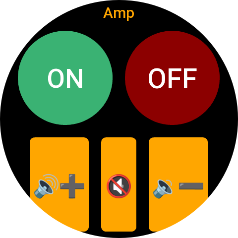
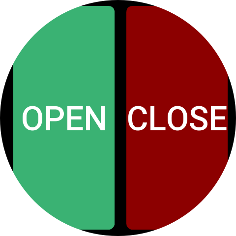
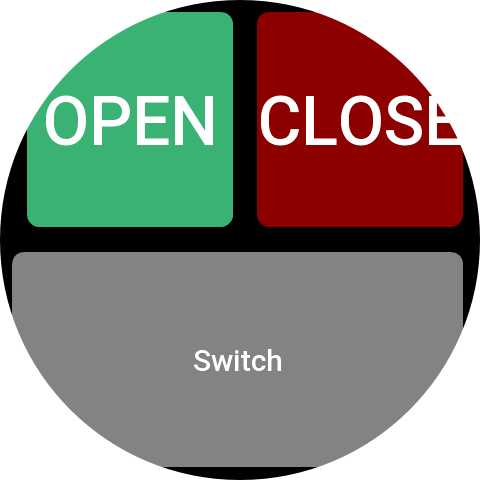
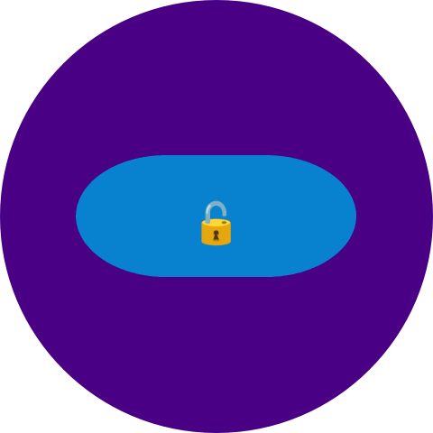
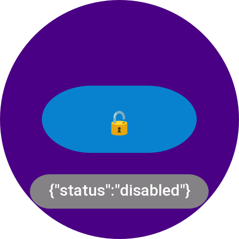
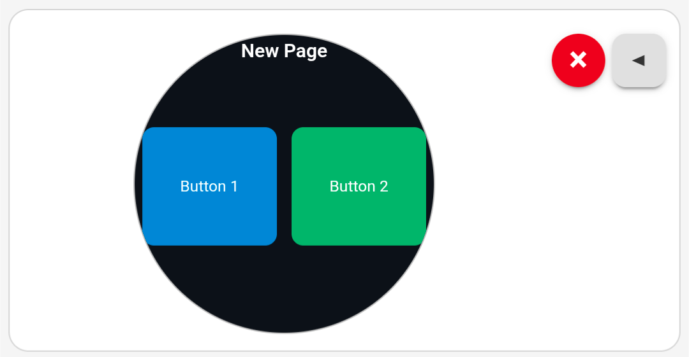
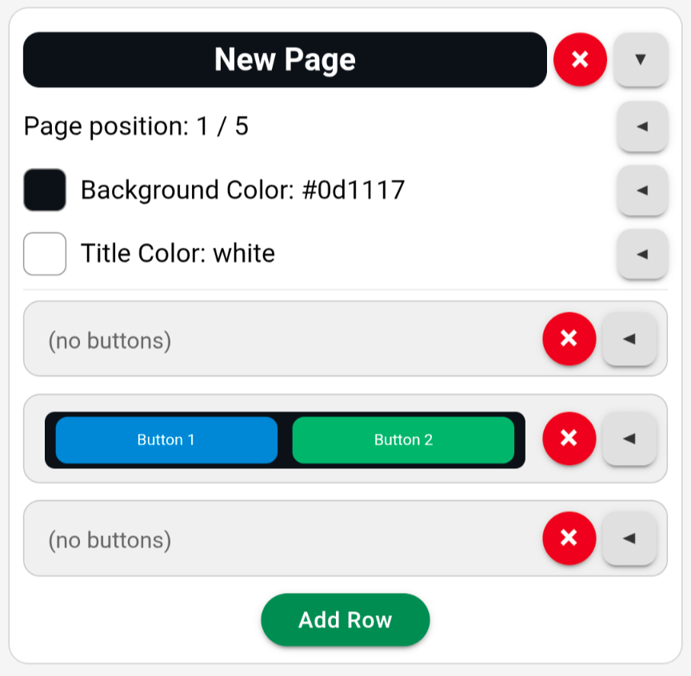
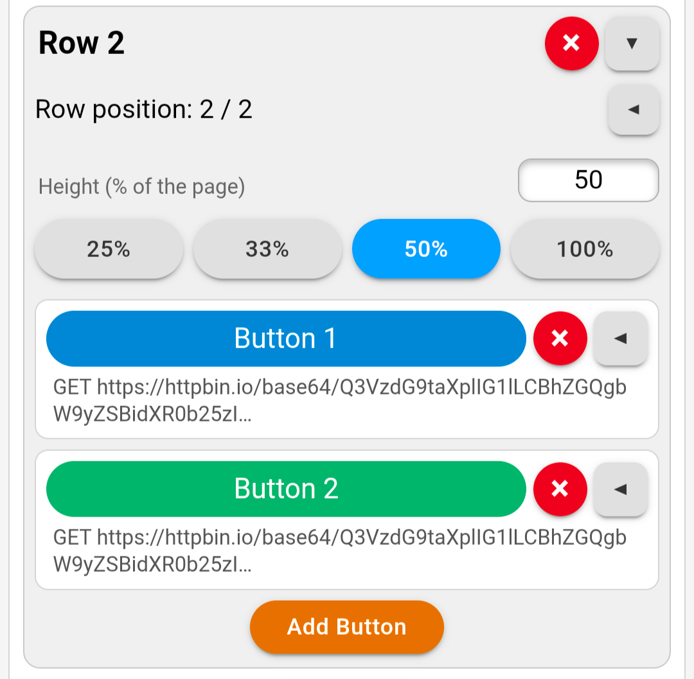
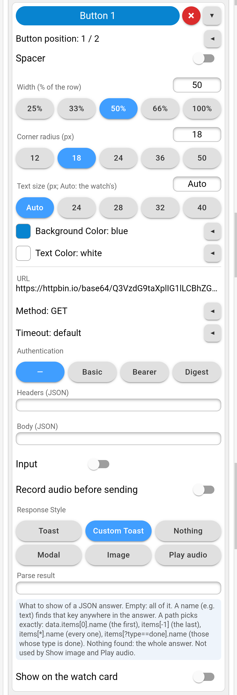

# HTTP-Buttons

A highly customizable ZeppOS application that lets you create buttons to trigger HTTP requests directly from your smartwatch. Perfect for home automation, IoT control, and quick API interactions.

## Screenshots

On the watch:

<p align="center">
  
  
  
</p>
<p align="center">
  
  
</p>

The settings page on the phone: a page's preview in the watch's shape, a page, a row and a button opened:

<p align="center">
  
</p>
<p align="center">
  
  
</p>
<p align="center">
  
</p>

## Features

- **Multiple Pages** — Swipe between different button layouts
- **Shortcut card** — Up to 6 buttons on a watch card (the widgets beside the watch face): a tap runs the button and comes back to the card, without opening the app
- **Customizable Buttons** — Set colors, sizes, radius, and text for each button
- **HTTP Methods** — Support for GET, POST, PUT, DELETE, PATCH, and more
- **Authentication** — Basic, Bearer, and Digest authentication support, plus an optional two-step (session) flow: login → token → reuse → logout
- **Global Variables** — Define reusable variables like IP addresses or tokens
- **Input Keyboard** — On-watch keyboard for dynamic request parameters
- **Response Handling** — Choose between toast, custom toast, modal, or silent notifications
- **Image Display** — Fetch a remote image (PNG/JPEG) and show it fullscreen on the watch
- **Audio** — Record from the watch's microphone and send it (a form upload, the raw body, or base64 in JSON), and play an MP3 a request returns
- **JSON Parsing** — Extract specific fields from API responses, with path expressions like `choices[0].message.content`, `[*]` wildcards and `[?field==value]` filters
- **Timeouts** — Global and per-button request timeouts (5–60 s) for slow endpoints
- **Async jobs** — A button can start a long job and check back until the result is ready
- **Settings with previews** — Every page shown as a preview in your watch's shape (round or square), with the real sizes, colors and spacing
- **Test mode** — A built-in suite of example buttons that tries every feature, without touching your config
- **Fast start** — The watch keeps a copy of the config and shows the buttons at once, then checks with the phone whether it changed (the copy, credentials included, stays in the app's own storage on the watch)
- **Loading feedback** — A pressed button shows an animation until its request is done; taps on a busy button wait their turn
- **Logs box (test builds)** — The settings page shows the latest watch and phone log lines, ready to copy into a bug report (passwords, tokens and variable values removed). Release builds log nothing and have no Logs box: if something doesn't work, open an issue and we can send you a test build with the logs on

## Installation

1. Install the app from the Zepp App Store
2. Open the Zepp app on your phone
3. Go to the app settings to configure your buttons (the example pages work right away)
4. Open the app once on the watch: it keeps a copy of your buttons from then on
5. Optionally, add the **HTTP-Buttons** card from the watch's list of cards

## Configuration

All configuration is done in the app's settings page on your phone:

- **Pages, rows and buttons** open and close: a closed page shows a preview in your watch's shape (once the watch has connected), a closed row a strip of its buttons, a closed button one line saying what it does (method and URL). The settings open with everything closed, and closing a page or a row closes what is inside it
- **Positions**: a page, a row or a button moves with its **position** buttons (1, 2, 3…)
- **Add Page**, **Add Row** and **Add Button** sit under what they add to; a new page starts with two colored buttons, centered
- **Sizes**: a row's height, a button's width, radius and text size are picked from the usual values, or typed in the field beside them. A ⚠ marks a row whose buttons are wider than 100% in all, or a page whose rows are taller than 100% (the watch then makes them all the same size)
- **Colors** are picked from a grid of swatches
- **Request**: URL (shown one query parameter a line), method, timeout, authentication (with user and password, or a token, hidden on screen), headers and body as JSON, an input keyboard, a recording, how the result shows (toast, custom toast, nothing, modal, image, play audio), the value to show (`parse_result`, explained under its field), and whether the button goes on the watch card
- **Variables**, the global **Request timeout** and the **Loading animation** for every button
- Deleting a page, row, button or variable, and **Re-Init configuration** (back to the example), ask for confirmation in the page
- **Configuration (raw JSON)** holds the whole config as JSON: copy it for a backup, or paste one back (only a config with a `"pages"` list is saved)
- **Test mode** loads a built-in test suite instead of your buttons; your config comes back when it is off

Buttons with a `session` or `poll` block (see below) say so on their card: those blocks are edited in the JSON.

### Global Variables

Define variables once and use them in any button URL, header, or body with `{variable_name}` syntax:

```json
{
  "variables": {
    "server_ip": "192.168.1.100",
    "api_token": "your-token-here"
  }
}
```

Then use in URLs: `http://{server_ip}/api/action`

### Input Buttons

Enable the "Input" option on a button to show an on-watch keyboard. The typed text replaces `{input}` in your request URL or body.

### Response Parsing (`parse_result`)

The `parse_result` field of a request extracts a value from the JSON response body instead of showing the whole payload. Two modes, chosen automatically:

- **Bare key** (no dots or brackets), e.g. `"fact"` — searches the whole response tree for that key name, at any depth, and shows every match. Simple and forgiving; ideal when the interesting field has a unique name.
- **Path expression** (contains `.` or `[…]`) — walks the exact path from the root:

| Expression | Meaning |
|---|---|
| `data.user.name` | nested field |
| `choices[0].message.content` | array element by index (`choices.0.…` works too) |
| `items[-1].id` | negative index counts from the end |
| `choices[*].message.content` | all elements — results are joined with commas |
| `choices[?finish_reason==stop].message.content` | only elements whose field equals the value |

The filter also accepts the JSONPath spelling `[?(@.finish_reason=='stop')]`; quotes around the value are optional. If a path expression matches nothing, the app falls back to the loose key search, and finally to showing the full response — so a wrong expression never hides the data.

### Request Timeouts

By default each request may run for **10 seconds** before failing. Slow endpoints (e.g. AI services that generate a response) may need more: raise the global **Request timeout** in the settings, or override it per button with its **Timeout** choice (5–60 s). The same timeout also bounds the image download of Image-style buttons.

> **Platform limit:** the phone's native HTTP client aborts a request after ~10 s of *silence* from the server (generic `network error`), regardless of the timeout configured here. The total duration may exceed 10 s as long as the server keeps sending bytes — timeouts above 10 s therefore only help with endpoints that stream or send keep-alive bytes while working. For servers that stay silent until the full response is ready, use an async pattern instead — see *Async jobs (polling)* below.

In the JSON config the value is in milliseconds: `"timeout"` at the top level sets the global default, `"timeout"` inside a button's `request` overrides it (a `session` block's `login`/`logout` sub-requests accept their own too):

```json
{
  "timeout": 20000,
  "pages": [ ... ]
}
```

```json
{
  "text": "🤖 Ask AI",
  "request": {
    "url": "https://host/webhook/ask",
    "method": "POST",
    "timeout": 45000,
    "response_style": 2
  }
}
```

### Loading Animation

While a button's request runs, the button shows an animation. Choose it in the settings ("Loading animation"), or with `"loading_style"` at the top level of the JSON config:

| Value | Animation |
|-------|-----------|
| `"pulse"` (default) | The button's border breathing |
| `"border"` | A white trail running round the button's border (black on light buttons) |
| `"corner"` | A small spinner in the button's top-right corner |

One request runs at a time per button: tapping a button that is still busy queues the tap (up to 10), and it fires as soon as the previous one is done. With an image button, the button stays busy until the picture is on screen.

### Shortcut Card

Up to 6 buttons can also sit on the app's **shortcut card**, among the cards beside the watch face. In the settings, open a button and switch on **Show on the watch card**; a collapsed button card then says "on card". Add the card from the watch's list of cards (it is called HTTP-Buttons).

A tap on a button of the card shows it, runs it like the app does (variables, authentication, sessions, polling, the typed text of an input button) and shows the result for a moment, then goes back to the card by itself; a tap goes back at once. An image button shows its picture full screen until a tap (at most 30 s). The card draws itself from the copy of the config the watch keeps, so open the app once after installing it. In the JSON, a card button has `"card": true`. An input button on the card asks for its text with the system keyboard (API_LEVEL 4.0 watches) or the app's own keyboard (older ones). An audio button records or plays on its own screen, as in the app. In test mode the card shows six buttons of the test suite.

### Image Display

Set a button's **response style** to **Image** to fetch a remote image (PNG or JPEG — e.g. an IP-camera snapshot) and show it fullscreen on the watch (tap to dismiss). The image is downloaded and converted on the phone, then pushed to the watch and scaled to fit the screen. Basic, Bearer, and Digest auth are supported.

```json
{
  "text": "📷 Camera",
  "request": {
    "url": "http://{cam}/snapshot?channel=0",
    "method": "GET",
    "auth": "Digest",
    "user": "admin",
    "pass": "password",
    "response_style": 4
  }
}
```

### Audio Buttons

**Recording.** Switch on **Record audio before sending** on a button: a press opens the recording screen ("● REC", the time, a bar up to the longest time). **Stop** or the watch's select key sends the recording, the back gesture cancels it; it stops by itself at the length you chose (5, 10, 15 or 30 s). The recording is sent as an Ogg Opus file (`audio/ogg`), with the button's URL, headers and authentication, in one of three ways:

| Send as | Body |
|---|---|
| `multipart` (default) | a form upload: the file `recording.ogg` in the form field you name (`file` by default) |
| `raw` | the file itself, `Content-Type: audio/ogg` (unless the headers set another) |
| `json` | the button's body, with `{audio}` replaced by the file in base64 (no body: `{"audio": "…"}`) |

A recording needs a body, so a GET or HEAD button sends it as POST. With **Input** on too, the watch asks for the text first, then records: the text goes in `{input}`, beside the recording. The answer shows in the button's response style once the watch is back on the buttons page.

```json
{
  "text": "🎤 Voice note",
  "request": {
    "url": "https://host/api/voice?chat={chat}",
    "method": "POST",
    "audio": { "seconds": 15, "send_as": "multipart", "field": "voice" },
    "response_style": 0
  }
}
```

**Playing.** Set a button's response style to **Play audio** (`"response_style": 5`): the answer is an audio file (MP3), which the phone downloads and the watch plays, with a progress bar; **Stop**, the select key or the back gesture ends it.

The watch's screen stays on while it records or plays. Recording needs a watch with a microphone, playing one with a speaker.

### Two-step (session) authentication

Some services don't accept static credentials on the action request: they require a **separate login** that returns a temporary token/session id, which you then reuse on the real request (e.g. session-based dashboards and hypervisor/NAS admin APIs). Add an optional `session` block to a button's `request` to support this. Buttons **without** a `session` block behave exactly as before.

The flow is: **login → extract token → inject into the main request → (optional) logout.** The login and logout are ordinary requests (they accept the same `url`, `method`, `headers`, `body`, and even their own `auth`). The extracted value is substituted wherever you write the `{{token}}` placeholder (URL, headers, body, …).

```json
{
  "text": "Reload",
  "request": {
    "method": "POST",
    "url": "https://host/api/reload",
    "headers": "{\"X-Session\": \"{{token}}\"}",
    "response_style": 1,
    "session": {
      "login":   { "method": "POST", "url": "https://host/api/login", "body": "{\"pass\":\"secret\"}" },
      "extract": { "path": "session.sid", "as": "token", "ttl": 1800, "ttl_path": "session.validity" },
      "logout":  { "method": "POST", "url": "https://host/api/logout", "headers": "{\"X-Session\": \"{{token}}\"}", "mode": "expiry" }
    }
  }
}
```

- **`login`** — the preliminary request that returns the token.
- **`extract.path`** — exact path to the value in the login response body (`session.sid`, `data.token`, `items[0].id` — dot and bracket indices supported). **`as`** names the placeholder (`{{token}}` here).
- **`extract.ttl`** — seconds to keep the token cached, so rapid presses reuse the same session instead of logging in every time. **`ttl_path`** (optional) reads the lifetime from the login response instead. With no ttl the token is not reused.
- **`logout`** (optional) — `mode: "each"` runs login → main → logout on every press; `mode: "expiry"` (default) keeps the cached session and logs out only when it expires or when the app closes.
- **Errors are labelled by phase** on the watch: `Auth: …` (login failed, main not run) vs `Req: …` (main failed); logout failures are silent.

The token cache is in-memory only. This flow applies to normal requests; image buttons ignore a `session` block.

### Async jobs (polling)

Some endpoints take longer than the platform allows (see the ~10 s silence limit under *Request Timeouts*) — typically AI workflows: the full answer isn't ready within the window the phone gives a single request. The fix is to split the work in two: the button's request only **starts** the job and returns immediately (e.g. with a job id), then the watch **polls** a second URL until the result is ready. Add an optional `poll` block to the button's `request`:

```json
{
  "text": "🤖 Ask AI",
  "request": {
    "method": "POST",
    "url": "https://host/webhook/ask",
    "body": "{\"q\": \"{input}\"}",
    "parse_result": "answer",
    "response_style": 2,
    "poll": {
      "extract": { "path": "id", "as": "job" },
      "url": "https://host/webhook/result?id={{job}}",
      "every": 2000,
      "max": 30,
      "until": "answer"
    }
  }
}
```

- **`url`** (required) — the poll request. Placeholders work as everywhere else: `{variables}`, `{input}`, the extracted `{{job}}`, and `{{token}}` when a `session` block is present. `method` defaults to GET; `headers`, `body`, `auth`/`user`/`pass`/`token` and `timeout` are accepted like on any request.
- **`extract`** — where in the *first* response the job id lives (`path`, dotted/bracket syntax; `as` names the placeholder, default `job`). Omit it if the poll URL needs no id.
- **`every`** — milliseconds between attempts (default 2000, clamped to 1–60 s). Attempts never overlap: the next wait starts when the previous attempt settles.
- **`max`** — attempts before giving up with `Poll: not ready…` (default 30, up to 120).
- **`until`** — path that must yield a non-empty value in a poll response for it to count as the result. Without it, the first 2xx response wins. Not-ready responses (404, errors) just schedule the next attempt.

The button's `parse_result` and `response_style` apply to the **final** poll response, and the button's loading animation runs until the poll settles. Polling only runs while the app is open on the watch; leaving the page cancels pending attempts. Image buttons ignore a `poll` block.

Server-side, any backend or automation platform can implement the matching pair: the start endpoint replies immediately (`{"id": "..."}`) and kicks off the work; the result endpoint returns `{}` while the job is running and `{"answer": "..."}` when done.

## Configuration Example

```json
{
  "variables": {
    "TV": "192.168.1.20",
    "AMP": "192.168.1.10"
  },
  "pages": [
    {
      "title": "Home",
      "back_color": 0,
      "rows": [
        {
          "h": 50,
          "buttons": [
            {
              "text": "ON",
              "w": 50,
              "back_color": 3978097,
              "radius": 100,
              "request": {
                "url": "http://{AMP}/on",
                "method": "GET",
                "response_style": 1
              }
            },
            {
              "text": "OFF",
              "w": 50,
              "back_color": 9109504,
              "radius": 100,
              "request": {
                "url": "http://{AMP}/off",
                "method": "GET",
                "response_style": 1
              }
            }
          ]
        }
      ]
    }
  ]
}
```

## Use Cases

- **Home Automation** — Control lights, thermostats, and smart devices
- **Camera Snapshots** — View an IP-camera still on your wrist
- **Media Control** — Play/pause, volume, channel switching
- **IoT Devices** — Trigger actions on single-board computers and microcontrollers on your network
- **API Testing** — Quick endpoint testing from your wrist
- **Shortcuts** — Run webhooks and automations on your home-automation hub or automation service
- **AI agents** — Ask a question and wait for the answer with an async job
- **Voice** — Send a voice note to a chat or a transcription service, or hear a spoken answer

## Compatibility

Works with ZeppOS 3.0+ devices (input buttons use the system keyboard on API_LEVEL 4.0 watches and the app's own keyboard on older ones, in the app and on the card; audio buttons need a microphone to record and a speaker to play), including:
- Amazfit GTR/GTS series
- Amazfit Balance, Cheetah, T-Rex Ultra
- And other ZeppOS compatible watches

## License

MIT License — see [LICENSE](LICENSE) for details.

---

Made with ❤️ for the ZeppOS community